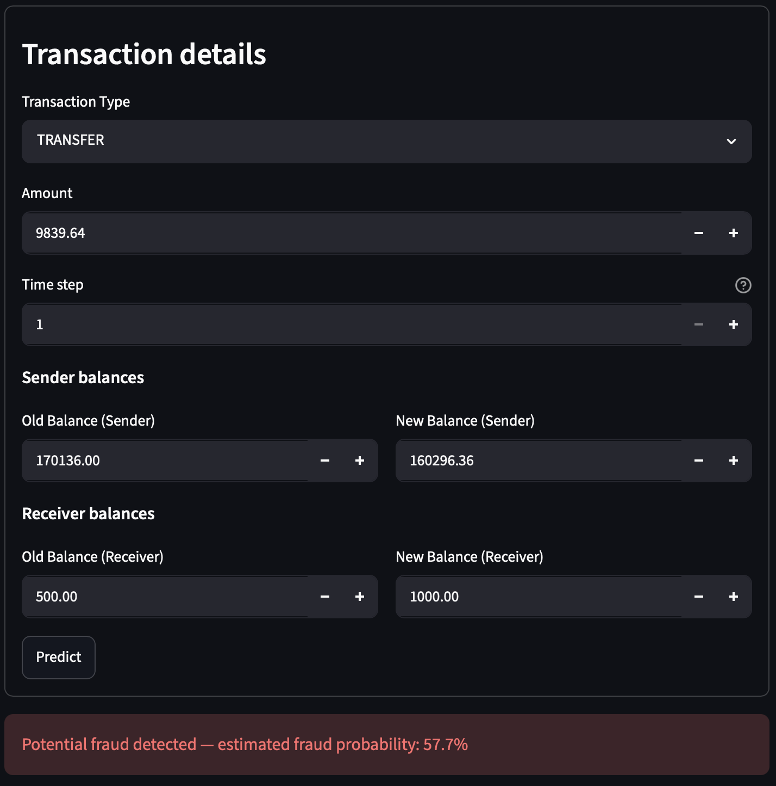
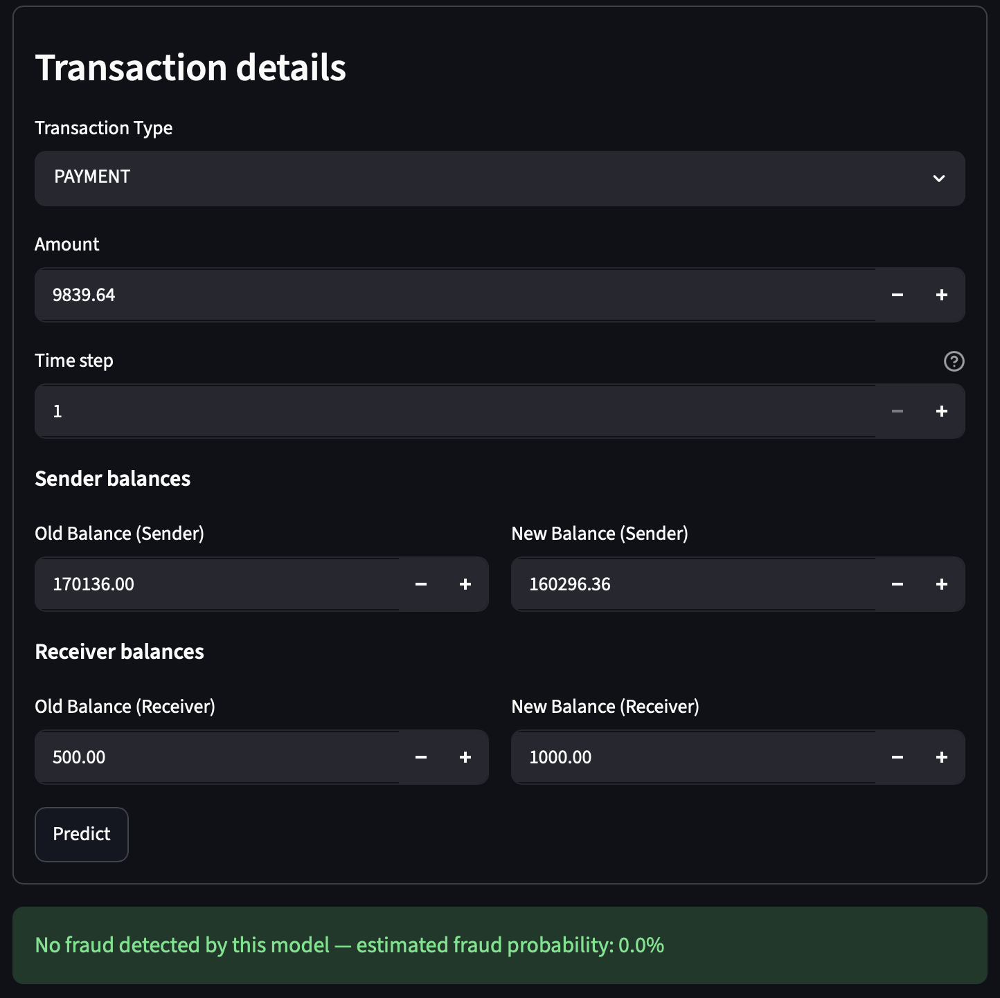

# Fraud Detection ML Implementation

A machine-learning app that estimates whether a transaction may be fraudulent using transaction details and account balances.

<p align="center">
  
  
</p>

## Problem
Fraudulent transactions are rare and can be difficult to distinguish from legitimate ones. This project explores how transaction data can be used to train a model that estimates the likelihood of fraud.

## Based on
Built using the `AIML Dataset.csv` transaction dataset. The dataset is not included in this repository because it is too large for a regular GitHub upload. Place your copy beside `fraud_detection.py` to run the app.

## Tech stack
Python, pandas, scikit-learn, Streamlit, Matplotlib

## Key features
- Exploratory analysis of the dataset
- Streamlit app with a transaction details form
- Logistic regression model trained from the CSV when the app first needs to make a prediction
- Fraud probability displayed with the prediction
- Trained model saved locally for reuse

## What I learned
- How to inspect transaction data and check for missing values and class imbalance.
- How to prepare numeric and categorical data for machine learning.
- How to split data into training and test sets.
- How to build an interactive prediction app with Streamlit.
- Why fraud predictions are estimates and should be evaluated with more than accuracy.

Full notes in [LEARNINGS.md](LEARNINGS.md)

## My changes
- **Automatic model training:** the app trains a starter model from the dataset when no saved model is available.
- **Transaction form:** users can enter the transaction type, amount, time step, and sender and receiver balances.
- **Imbalanced data handling:** the model uses class weighting to account for the lower number of fraud examples.
- **Local model saving:** after training, the app saves the model so it can be reused on later runs.

## How to run
```bash
python -m pip install streamlit pandas scikit-learn joblib matplotlib
streamlit run fraud_detection.py
```

Keep AIML Dataset.csv in the project folder. The app uses up to 500,000 rows by default when training.
## Results
The app displays a fraud prediction and estimated fraud probability for each submitted transaction. Results depend on the training data and are not proof that a transaction is fraudulent.

## Demo video
[link]
